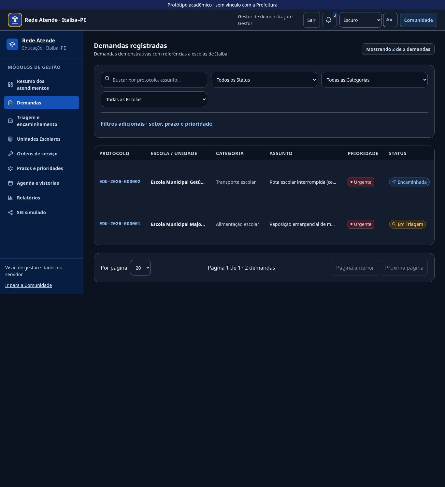

# Revisão da demonstração — 18/11/2026

Base examinada: `a0a193e25c2baa664b43d4c8196891eedb56ea95`, versão **3.12.0**, pasta `Rede_Atende_Itaiba`. Os 207 arquivos recebidos do GitHub tiveram seus hashes Git conferidos antes da alteração. O snapshot de fontes foi preservado antes das mudanças. Não havia banco, anexos ou configuração do notebook do usuário neste ambiente; todos os testes usaram bases descartáveis.

Branch: `correcoes/demonstracao-temas-acesso`. A `main` foi preservada. O contrato `/api/v1`, as migrações, o formato dos protocolos e as permissões do servidor continuam com os mesmos contratos.

## Diagnóstico por prioridade

| Prioridade | Constatação antes da mudança | Resultado e referência nos fontes atuais |
| --- | --- | --- |
| P0 | Nenhuma quebra de autenticação/RBAC foi confirmada nos testes executados. | Preservadas as verificações do servidor, o cadastro exclusivamente como cidadão, o auditor em consulta e a reabertura exclusiva do gestor. |
| P1 | Cidadão em `/admin` encontrava um cartão sem cabeçalho ou saída. | Página completa, Voltar à comunidade, troca de conta por logout real, estado de espera e tratamento de falha. [RequireAccess.tsx:7](../src/components/common/RequireAccess.tsx#L7). |
| P1 | O cabeçalho oferecia Gestão ao cidadão autenticado. | Atalho oculto para cidadão; equipe mantém acesso e visitante pode chegar ao login. [Header.tsx:152](../src/components/common/Header.tsx#L152). |
| P1 | Alto contraste era a única opção escura; tema e fonte se perdiam ao remontar o cabeçalho. | Claro, Escuro e Alto contraste, com armazenamento local independente das contas e aplicação antes de renderizar. [AccessibilityToolbar.tsx:14](../src/components/common/AccessibilityToolbar.tsx#L14), [appearance.ts:1](../src/utils/appearance.ts#L1) e [index.css:38](../src/index.css#L38). |
| P1 | As senhas já persistiam corretamente no banco, mas não havia recuperação local explícita e auditada. | Comando restrito aos quatro e-mails fictícios, confirmação explícita, backup anterior, hash scrypt, revogação das sessões da conta e evento de auditoria. [reset-demo-password.mts:1](../scripts/reset-demo-password.mts#L1). |
| P1 | A criação das contas era confirmada em transações individuais; uma senha inválida posterior podia deixar instalação parcial. O arquivo de acesso também precisava considerar conflito de INSERT e permissões existentes. | Criação das contas numa transação, credenciais somente para INSERT confirmado, arquivo privado `0600` nos sistemas que suportam essas permissões e atualização da entrada correta após reset. Contas existentes não são rotacionadas pelo setup. [seed.ts:12](../server/db/seed.ts#L12) e [demoAccess.ts:11](../server/db/demoAccess.ts#L11). |
| P2 | O login de retorno à gestão descrevia apenas o uso por cidadão. | Orientação própria para a equipe, mantendo claro que cadastro público cria somente cidadão. [Login.tsx:17](../src/pages/community/Login.tsx#L17). |
| P2 | Uso alternado de `localhost` e `127.0.0.1` podia confundir cookies, preferências e cache. | Roteiro usa `http://127.0.0.1:3001` de forma consistente; as duas origens foram verificadas no teste offline. [Guia local](ACESSOS_LOCAIS.md). |

A classificação P1 indica impacto na demonstração e na recuperação local; não significa que tenha sido demonstrada invasão ou exposição de dados.

## Temas e acessibilidade

O tema escuro usa fundo `#0B1220`, superfícies `#131D2E`, texto principal `#F1F5F9`, secundário `#CBD5E1` e destaque `#93C5FD`. Os tokens distinguem controles, foco, bordas, avisos, erros e sucesso. As utilidades existentes foram mapeadas por classes exatas; o tema escuro não usa seletores genéricos por trecho de classe. O alto contraste original foi preservado.

As combinações centrais de texto da paleta escura tiveram contraste calculado de 7,84:1 a 15,42:1; os pares e valores estão no resultado estruturado. O eixo dos gráficos acompanha os tokens. Formulários, listas, tabelas, bloqueio de acesso, login, triagem e dashboard foram incluídos na matriz de 360, 390, 768 e 1366 px nos três temas. Os modais de detalhes da demanda e guia de acesso também receberam verificações em 390 e 1366 px. Os testes usam axe com regras WCAG A/AA e conferência de overflow; isso não substitui avaliação humana ou testes com leitores de tela.

## Contas, permissões e persistência

O teste de recuperação cobre senha inválida sem criação parcial, repetição de setup sem mudança de IDs/hashes, perda do arquivo sem anúncio de credencial fictícia, permissões do arquivo, recusa de reset sem confirmação, conta fora do escopo, banco portátil ocupado, backup anterior, auditoria e novo login. Nenhuma senha real foi incluída nos fontes, capturas ou documentação; as senhas fixas dos testes existentes são exclusivas dos ambientes sintéticos descartáveis.

O fluxo de cidadão e gestor usa sessões independentes. A suíte inclui criação, consulta, complemento, correção de categoria, setor, prioridade, responsável, ordem de serviço, conclusão, reabertura e avaliação conforme as permissões já previstas. A API continua omitindo os campos internos da projeção do cidadão. A edição do perfil administrativo não foi acrescentada.

O teste de persistência existente reabre o banco em processos distintos, repete setup e verifica solicitações/anexos. O novo teste offline também verifica uma alteração real do gestor e os bytes de um PDF depois de reiniciar a API. Todos os protocolos desses testes foram gerados nas próprias execuções. O protocolo `EDU-2026-000003` é apenas uma referência histórica; não foi consultado o banco da apresentação anterior.

## Página offline

O service worker original já usa rede primeiro para navegações. Não foi desativado nem reescrito. O teste `npm run test:offline` serve o build real na porta 3001, abre o acompanhamento, para o servidor, abre a página offline, reinicia o servidor e recarrega. O título `Sem conexão · Rede Atende` desapareceu quando a página real carregou, tanto em `127.0.0.1` quanto em `localhost`. Sessão, edição, protocolo e PDF permaneceram íntegros.

Portanto, o problema visto no Brave não foi reproduzido neste ambiente; não há causa comprovada para justificar alteração do cache. A documentação orienta manter a mesma origem e iniciar o servidor antes de recarregar. Não foi implementado envio de solicitações offline.

## Resultados executados

Ambiente: Linux, Node **24.22.3**, npm **11.9.0**, PGlite **0.4.6**, Playwright **1.64.1** e Chromium **153.0.8010.0** (Headless Shell) fornecido por `@sparticuz/chromium` **153.0.0**. O binário alternativo foi usado somente no ambiente de validação; não foi adicionado às dependências do projeto. No Windows, os mesmos scripts são chamados com `npm.cmd`.

| Comando | Resultado efetivo |
| --- | --- |
| `npm run test:static` | **14/14 aprovados**. |
| `npm run typecheck` | Aprovado. Inclui o novo comando de recuperação. |
| `npm run lint` | Aprovado. |
| `npm test` | **155/155 aprovados**. |
| `npm run test:api` | **72/72 aprovados**, incluindo seis testes novos de seed/recuperação. |
| `npm run build` | Aprovado. Novo build executado depois da última alteração da interface. |
| `npm audit --omit=dev` | **0 vulnerabilidades reportadas** na consulta executada. |
| `npm run test:persistence` | Aprovado, inclusive reabertura em outro processo e restauração física isolada. |
| `npm run test:offline` | Aprovado nas duas origens, com interrupção real do servidor. |
| `npm run test:e2e -- --project=chromium` | **87/87 aprovados** na execução final isolada, sem falhas, pulados ou casos instáveis. |
| Prettier nos arquivos de implementação alterados e `git diff --check` | Aprovados. |

Uma tentativa inicial do Chromium do sistema foi bloqueada pelo ambiente. A primeira suíte completa posterior teve 80 aprovações e uma falha de infraestrutura: duas execuções compartilharam a pasta de traces. Esse resultado não foi contado como aprovação integral. Outra execução teve 86 aprovações e uma interrupção por recarregamento durante a análise de um modal; o trace foi examinado. A preparação dos temas passou a ignorar páginas auxiliares sem armazenamento, e a suíte final foi executada com os arquivos congelados: 87/87 aprovados. Os 15 cenários novos de prontidão e os seis de modais também passaram em execuções focadas.

## Limites da verificação

**Não verificados nesta revisão:** Windows 11 físico, Brave, Safari/WebKit, iPhone físico, leitor de tela, PostgreSQL externo e o banco/vídeo da apresentação anterior. Os resultados de Chromium e PGlite não são uma homologação desses ambientes. Não houve publicação de um serviço público na internet.

Os componentes maiores continuam com 641 linhas em `NewRequest.tsx`, 646 em `AdminTriage.tsx`, 671 em `AdminDemands.tsx` e 1.147 em `RequestEngine.ts`. Não houve evidência que justificasse refatoração extensa para esta correção; os contratos e a estrutura foram preservados.

## Revisão e apresentação

As mudanças de interface ([`99565f1`](https://github.com/rmrdotsk-rgb/Rede-Atende/commit/99565f1db73487b5a97f010c218a50477f011de6)) e de recuperação local ([`d5828e8`](https://github.com/rmrdotsk-rgb/Rede-Atende/commit/d5828e877d26f2601e6bc29954fdfedc3fdea77a)) estão separadas em commits. As mensagens antigas, incluindo `chore:` e `docs:`, não foram reescritas. O nome público permanece **Rede Atende** e o nome técnico do repositório permanece **Rede-Atende**. A descrição da página do repositório não foi alterada; o responsável pode removê-la nas opções de apresentação do GitHub se desejar.

- [Instalação, acesso, início/encerramento e recuperação no Windows](ACESSOS_LOCAIS.md)
- [Roteiro de demonstração de 6–8 minutos](ROTEIRO_DEMONSTRACAO_ATUAL.md)
- [Resultado estruturado desta revisão](validacao/demonstracao-2026-11-18.json)

Para reverter, reverta o commit de interface ou de recuperação na branch e gere outro build. O rollback de fontes não deve apagar `.env`, `.local`, banco ou anexos. Uma senha já redefinida exige outro reset explícito para retornar à senha anterior; reverter código não altera o hash no banco.
